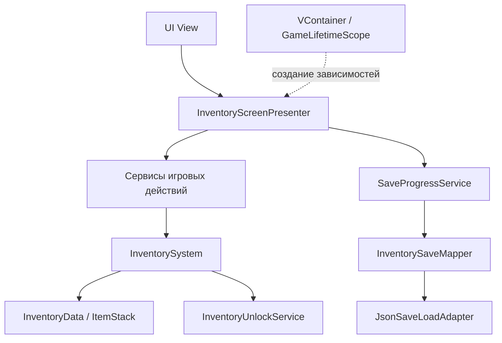

# TestTaskInventory — система инвентаря на Unity

Тестовое задание на **Unity / C#**: система инвентаря с ограничениями стаков, разблокировкой ячеек за игровую валюту и сохранением прогресса.

Основной акцент — на разделении игровой логики, представления и инфраструктуры, чтобы инвентарь можно было развивать независимо от UI.

## Возможности

- **50 слотов**, из которых **15 открыты изначально**; остальные разблокируются последовательно за монеты.
- Несколько типов предметов: оружие, броня и патроны.
- Добавление патронов в неполные стаки и свободные слоты с учётом максимального количества.
- Добавление и удаление случайного предмета, случайный выстрел из доступного оружия с расходованием боеприпаса.
- Подсчёт суммарного веса содержимого инвентаря.
- JSON-сохранение валюты, состояния слотов и предметов.
- Интерфейс с отображением заблокированных и открытых слотов, количества предметов и общей информации.

## Стек

**Unity 2022.3.62f3**, **C#**, **uGUI**, **VContainer 1.17.0**, **ScriptableObject**, **JSON**.

## Архитектура

Проект разделён на несколько уровней ответственности:

| Уровень | Назначение | Ключевые классы |
|---|---|---|
| Данные и доменная логика | Слоты, стаки, кошелёк, правила инвентаря | `InventoryData`, `InventorySlotData`, `ItemStack`, `Wallet`, `InventorySystem` |
| Прикладные сервисы | Операции добавления, удаления, стрельбы и открытия слотов | `AddRandomItemService`, `AddRandomAmmoService`, `ShootRandomWeaponService`, `InventoryUnlockService` |
| UI / MVP | События пользовательских действий, отрисовка состояния | `InventoryScreenPresenter`, `InventoryActionsView`, `InventoryGridView` |
| Инфраструктура | Загрузка конфигов, сохранения, DI | `StaticDataService`, `JsonSaveLoadAdapter`, `InventorySaveMapper`, `GameLifetimeScope` |



### Почему эта организация важна

- **UI не управляет содержимым слотов напрямую.** Presenter обрабатывает действия и обновляет View; операции выполняют сервисы и `InventorySystem`.
- **Данные отделены от сохранений.** `InventorySaveMapper` преобразует runtime-модели в сериализуемые DTO и обратно.
- **Результаты операций явные.** Например, `AddAmmo` возвращает количество добавленных патронов, остаток и список изменившихся слотов.
- **Параметры предметов настраиваются через ScriptableObject:** вес, максимальный стак, категория и визуальные данные.

## Интересные участки кода

- [`InventorySystem.cs`](Assets/Scripts/Core/Systems/InventorySystem.cs) — добавление патронов, расходование боеприпасов, работа со слотами, расчёт веса.
- [`InventorySlotSelector.cs`](Assets/Scripts/Services/InventorySlotSelector.cs) — поиск подходящих свободных и занятых слотов.
- [`InventoryUnlockService.cs`](Assets/Scripts/Services/InventoryUnlockServices/InventoryUnlockService.cs) — последовательная разблокировка с проверкой кошелька.
- [`InventoryScreenPresenter.cs`](Assets/Scripts/UI/InventoryScreen/Presenters/InventoryScreenPresenter.cs) — связка игровых действий и представления по MVP.
- [`InventorySaveMapper.cs`](Assets/Scripts/GameSaveDatas/InventorySaveMapper.cs) — преобразование данных для сохранения.
- [`GameLifetimeScope.cs`](Assets/DI/GameLifetimeScope.cs) — регистрация зависимостей через VContainer.

## Запуск

1. Открыть проект в **Unity 2022.3.62f3**.
2. Дождаться установки пакетов через Package Manager (включая VContainer).
3. Открыть сцену [`Assets/Scenes/SampleScene.unity`](Assets/Scenes/SampleScene.unity).
4. Запустить **Play**.

## Проверка логики вне Unity

В папке [`Tests/Inventory.DomainChecks`](Tests/Inventory.DomainChecks) расположен небольшой консольный набор проверок доменной модели. Он подключает **исходные файлы проекта**, а не их переписанные копии.

Требуется .NET SDK 8 или выше:

```bash
dotnet run --project Tests/Inventory.DomainChecks/Inventory.DomainChecks.csproj
```

Этот набор предназначен для быстрых регрессионных проверок кошелька, стаков, сериализуемых DTO и правил разблокировки. **Это не Unity Test Framework**: игровой UI и загрузка Unity-сцены отдельно проверяются в редакторе.

## Демонстрация

Планируется добавить короткие записи реальной работы проекта: добавление патронов и заполнение стаков, открытие слота за монеты, расходование патрона при выстреле.

<!-- После добавления реальной записи можно включить:

-->

---

Проект выполнен в формате тестового задания. Цель — показать подход к реализации игровых систем и организации зависимостей, а не законченный коммерческий продукт.
