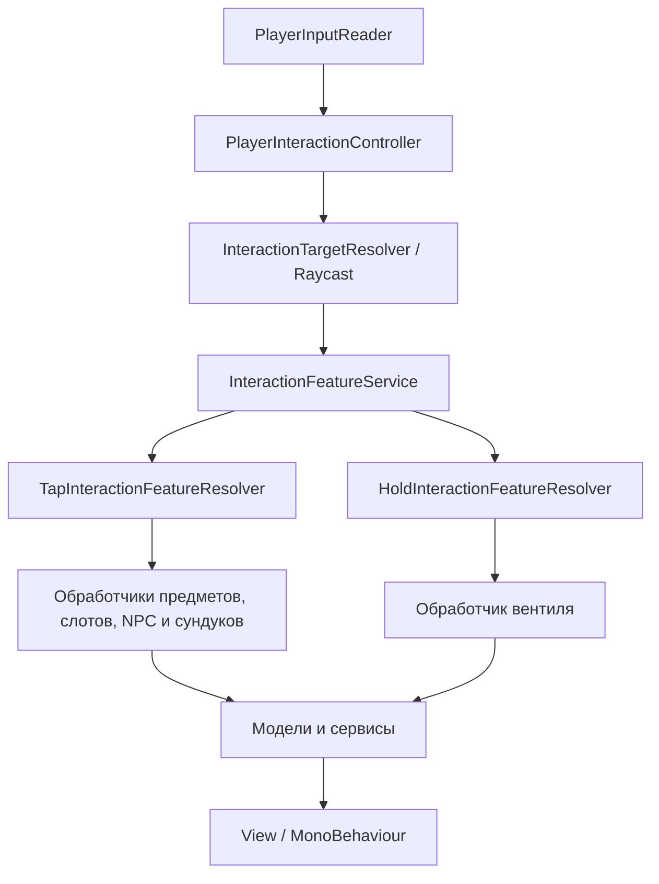

# Pick-up-adventure — система взаимодействия с игровым миром

**Unity 6 · C# · New Input System · VContainer · State Machine · ScriptableObject**

Тестовый 3D-проект, в котором реализована система контекстного взаимодействия с предметами и объектами окружения. Основная инженерная задача — поддержать разные сценарии (нажатие, удержание, осмотр, перенос предметов, диалоги) через общую точку входа, не превращая компоненты сцены в набор специальных условий.

## Реализованные механики

- **Контекстное взаимодействие одной кнопкой:** поиск цели лучом от камеры, отображение доступного действия, обработка нажатия и удержания.
- **Подбор и осмотр предметов:** первая встреча открывает отдельный режим осмотра с описанием и вращением предмета; повторное действие позволяет забрать его в руку.
- **Перенос и размещение предметов:** один и тот же объект перемещается между миром, режимом осмотра, рукой игрока и слотами.
- **Слоты с правилами размещения:** универсальный слот или ограничение по идентификатору предмета.
- **Сундук:** взаимодействие с проверкой подходящего ключа.
- **Вентиль и дверь:** действие с удержанием, изменяющее состояние связанного механизма.
- **NPC, диалоги и квест:** ветвящиеся диалоги, выборы и интеграция с простым квестовым сценарием.

## Как организован код

Проект разделён по функциональным областям: `Interaction`, `Items`, `Slots`, `Player`, `DialogueSystem`, `NPC`, `Chest`, `ValveDoor`. Внутри этих модулей отделены модели состояния, сервисы, настройки и визуальные компоненты.

**Роль компонентов:** `MonoBehaviour` отвечает преимущественно за представление и работу с Unity API; сценарии и правила взаимодействия выполняются сервисами. Объекты передают контекст действия через `InteractableView`, а тип взаимодействия определяет нужный обработчик.

### Решения, на которые стоит посмотреть

**Расширяемое взаимодействие.** Обработчики реализуют `ITapInteractionFeature` или `IHoldInteractionFeature`, а соответствующие резолверы находят их по `InteractableItemType`. Новые типы объектов подключаются через обработчик и регистрацию в DI, без расширения одного большого `switch` по всем механикам.

**Разделение данных и представления.** Данные предметов и слотов хранятся в моделях. Перенос предмета ко взгляду, в руку или на полку выполняется отдельным сервисом, использующим тот же экземпляр объекта, а не создающим копии.

**Режимы игрока.** Машина состояний переключает обычный режим, осмотр предмета и диалог. В режиме осмотра управление камерой и перемещением настраивается отдельно.

**Data-driven настройки.** Содержимое предметов и параметры игровых объектов конфигурируются с помощью `ScriptableObject`, а экземпляры создаются через фабрики и спавнеры.

## Навигация по исходникам

| Подсистема | Основной код |
|---|---|
| Точка входа взаимодействий | [`InteractionFeatureService.cs`](Assets/_ProjectFiles/Interaction/Scripts/Core/InteractionFeatureService.cs) |
| Поиск обработчика нажатия | [`TapInteractionFeatureResolver.cs`](Assets/_ProjectFiles/Interaction/Scripts/Core/TapFeatureServices/TapInteractionFeatureResolver.cs) |
| Поиск обработчика удержания | [`HoldInteractionFeatureResolver.cs`](Assets/_ProjectFiles/Interaction/Scripts/Core/HoldFeatureServices/HoldInteractionFeatureResolver.cs) |
| Передача предметов между состояниями | [`ItemTransferService.cs`](Assets/_ProjectFiles/Interaction/Scripts/Core/TransferServices/ItemTransferService.cs) |
| Сценарий первого осмотра | [`FirstPickUpFlow.cs`](Assets/_ProjectFiles/Items/Scripts/Logic/FirstPickUpFlow.cs) |
| Контроллер взаимодействия игрока | [`PlayerInteractionController.cs`](Assets/_ProjectFiles/Player/Scripts/Core/PlayerInteractionController.cs) |
| Композиция зависимостей | [`GameLifetimeScope.cs`](Assets/DI/GameLifetimeScope.cs) |

## Как открыть проект

1. Клонировать репозиторий и открыть папку проекта через Unity Hub.
2. Использовать **Unity 6000.2.6f2** (версия, указанная в `ProjectSettings/ProjectVersion.txt`).
3. Дождаться импорта ассетов и восстановления пакетов. Для загрузки VContainer из Git необходим установленный Git.
4. Открыть сцену [`Assets/_ProjectFiles/Scenes/MainScene.unity`](Assets/_ProjectFiles/Scenes/MainScene.unity).

> Это демонстрационный проект в рамках тестового задания, а не готовая к релизу игра. Акцент сделан на игровой логике, структуре взаимодействий и расширяемости, а не на финальной визуальной полировке.

<!--
После записи геймплея добавьте папку Media и раскомментируйте блок ниже.

## Демонстрация механик

-->
